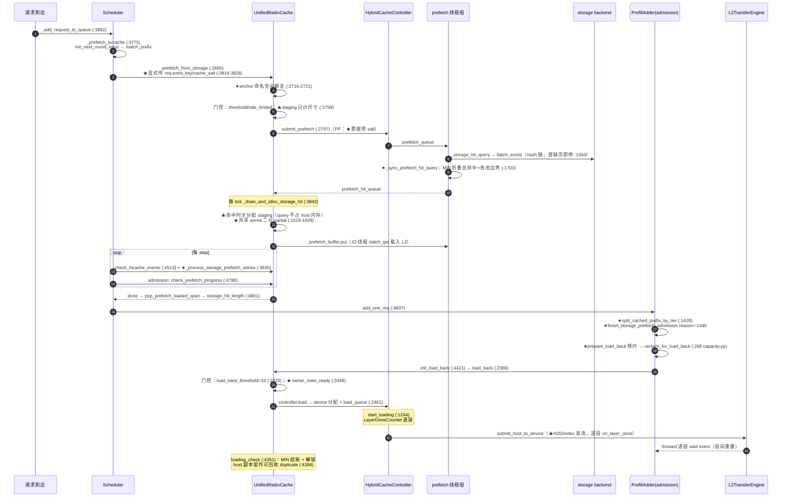

# 精读笔记 03：main 分支 HiCache 请求执行链路与数据流

> 校订日期：2026-11-21。
> SGLang 核验基线：`main@e183c415bdfc5995f6288b1651e1c320c6a74015`（2026-11-20 15:17 +0800，
> 浅克隆 `/tmp/sglang-main-audit`，与 diff 报告的对照端 789abb9be 相差一天，个别行号/默认值有微小漂移，下文均已按 e183c415b 复核）。
> 前置文档：`docs/02-hicache-dataflow.md`（基线 67853c58，hiradix_cache 时代）、
> `docs/upstream/2026-11-20-memcache-diff-6afee75f-to-main.md`（版本间静态 diff）。
> 本文档以"一条请求在 `--enable-hierarchical-cache` 下的完整生命周期"为主线，全部结论标注 文件:行号；
> 推断性内容单独标注（**推断**）。链路图中 ★ = 相对 6afee75f（kvtier 实验基线）新增或变更的节点。
> 路径前缀约定：`python/sglang/srt/` 简写为 `srt/`。

## 〇、总览：main 的 HiCache 组件图谱

| 组件 | 路径 | 责任 |
|---|---|---|
| `Scheduler` | `srt/managers/scheduler.py` | 请求入队即发 L3 prefetch；每 step 驱动 `check_hicache_events` 与 L3 miss 重试梯；admission 门 |
| `PrefillAdder` | `srt/managers/schedule_policy.py` | admission 时预算检查 + `init_load_back`（L2→L1 回载）+ L3 命中结账 |
| `UnifiedRadixCache` | `srt/mem_cache/unified_radix_cache.py`（5012 行） | 唯一的前缀树入口；吸收了旧 `HiRadixCache` 全部语义（prefetch/load-back/evict_host/retraction） |
| TreeCore | `srt/mem_cache/unified_cache/unified_tree_core.py`（Python）+ `rust_tree_core/adapter.py`（Rust 绑定，默认 `SGLANG_UNIFIED_RADIX_TREE_CORE_BACKEND=rust`，`environ.py:822`） | 树结构、LRU、lock/host_lock、backup 写策略门控（hit_count）、驱逐游标 |
| `HybridCacheController` | `srt/mem_cache/hybrid_cache/hybrid_cache_controller.py`（继承 `srt/managers/cache_controller.py:HiCacheController`） | D2H/H2D 队列、storage prefetch 线程组、共享 host arena 分配、PP prefetch 票据 |
| `L2TransferEngine` | `srt/mem_cache/l2_transfer.py`（282 行） | 三条专用 device stream（D2H / H2D / ★index）上的传输提交 |
| host pools | `srt/mem_cache/pool_host/{base,common,group,mha,mla,page_unified,unified}.py` | host 内存分配（pinned/hugetlb/shm）、布局、kernel/direct 搬运实现 |
| `hicache_auto_size` | `srt/mem_cache/hicache_auto_size.py` | ★cgroup 感知 host 池自动定容 |
| 容量仲裁 | `srt/mem_cache/capacity.py` + `prefill_budget.py` | ★reclaim 纪律（windows-first）、load-back/prefill 预约制 admission |
| L3 storage | `srt/mem_cache/hicache_storage.py` + `storage/{file,fast_file,...}/` | 页级内容寻址持久层；file / ★fast_file / mooncake / hf3fs / … |
| `BufferModePipeline` | `srt/mem_cache/buffer_mode/pipeline.py` | `--hicache-host-memory-mode buffer_only` 时 host 内存只做暂存，不做 L2 层 |
| `StorageAttachment` | `srt/mem_cache/unified_cache/storage_attachment.py` | L3 后端运行时 attach/detach |
| `UnifiedCacheLinker` | `srt/mem_cache/unified_cache/unified_cache_linker.py` | ★"无 host 层直连 L3"的旁路（mooncake_direct/umbp_direct linker） |

```text
token / prefix key（RadixKey：token_ids + extra_key + cache_salt）
        │
        ▼
UnifiedRadixCache ── TreeCore（默认 Rust）        索引 / 生命周期 / 写策略门控
        │
        ├── L1 device KV pools                    GPU 张量 + 物理槽（ChainAllocator / 共享字节 arena）
        ├── L2 host pool group                    pinned host 内存（cache 模式常驻 / buffer 模式暂存）
        └── L3 storage backend                    页内容 hash 链寻址（file / fast_file / 远端）
```

与 6afee75f 的最大结构差异：`hiradix_cache.py`（2026 行）已删除，HiCache 不再是"radix tree 的一个子类装饰"，
而是 `UnifiedRadixCache` 内聚的三层生命周期 + 独立的 controller/传输/host/storage 四个协作面。

---

## 一、调度器侧：从请求进入到 admission

### 1.1 入队即 prefetch

非 PD 模式下，请求经 `_add_request_to_queue`（`scheduler.py:3892`）进入 waiting queue 之前调用
`_prefetch_kvcache(req)`（`scheduler.py:3912`；PD prefill 模式 `:3922`）。被 retraction 重回队列的请求重置
L3 重试状态（`:3905-3908`：`storage_prefetch_retry_attempts=0`、`storage_prefetch_last_match=None`、
`staged_prefetch_plan=None`）。

`_prefetch_kvcache`（`scheduler.py:3775-3828`）的决策序列：

1. external linker 模式直接转 `tree_cache.linker.prefetch(req)`（`:3776-3777`）；
2. `req.init_next_round_input(tree_cache, cow_mamba=False)`（`:3779`）——内部走
   `match_kv_cache` → `UnifiedRadixCache.match_prefix`（`schedule_batch.py:1140-1206`），把
   `prefix_len`（device 命中）、`host_hit_length`、`last_node`、`last_host_node` 写回 req；
3. buffer 模式下 host 树没有驻留值，anchor 退到最深的 device 节点（`:3789-3794`，anchor 只读
   hash/extra-key 上下文、从不上锁）；
4. 发起门槛（`:3799-3806`）：cache 模式要求 `is_backuped(last_host_node)`（或 root）；buffer 模式只要求
   anchor 有 hash 值；
5. `storage_prefetch_end()`（`mem_cache/common.py:158`）计算 L3 探测右端点（≤ max_prefix_len），
   `new_input_tokens = fill_ids[matched_len:match_end]`；
6. **调用点显式携带请求自身的命名空间**（`:3818-3828`）：
   `tree_cache.prefetch_from_storage(handle, last_host_node, new_input_tokens, last_hash, prefix_keys,
   matched_prefix_tokens=..., extra_key=req.extra_key, cache_salt=req.cache_salt, storage_hit_end=...)`。
   ★这是 6afee75f→main 的关键修复：基线不传 salt，root anchor 退化成无命名空间的 L3 查询（diff 报告主题 1）。

PP 场景：`_bind_pp_arrival_prefetch`（`scheduler.py:3749-3762`）——PP0 在请求到达时决定 L3 票据，
后续 PP stage 在同一 step 取相同 match，避免树漂移。

### 1.2 L3 miss 重试梯（★main 新增）

`StoragePrefetchRetries`（`mem_cache/storage_prefetch.py:22-78`）是 admission 前的 L3 重查调度器：

- 只管"新 L3 尝试"；parked IO 与保留 staging 在各自 owner 处重试（类 docstring `:23-25`）；
- `pop_ready(waiting_queue, interval, max_attempts)`（`:43-78`）：步进计数器 + 到期步
  （`due_step = step + interval`，`:72-73`），**队头永不因 speculative miss 被拖延**（`:49-53` 直接 cancel
  队头的非 immediate 重试）；超过 `max_attempts` 的请求被 cancel，"admitted with whatever the device holds"；
- 参数：`--hicache-storage-prefetch-retry-poll-interval`（默认 8 个调度 pass）与
  `--hicache-storage-prefetch-retry-max-attempts`（默认 8），`arg_groups/fields/memory.py:195-216`。

驱动点：`get_next_batch_to_run` → `_process_hicache_events`（`scheduler.py:4300-4314`，每个 step 先于
其他决策执行，注释明确"consensus over one DP rank's attention TP and CP ranks"）→
`_process_storage_prefetch_retries`（`:3830-3841`）→ `_retry_storage_prefetch`（`:3843-3861`，到顶时
WARNING "the request is admitted without further L3 lookups"）。

配套的还有 **队列期 device 命中收缩重查**：`_prefetch_after_device_hit_loss`（`scheduler.py:3863-3890`）——
排队期间 device 前缀被逐导致 `current_match_len < storage_prefetch_last_match_len` 时，对新暴露的 L3 区间
重新发起查询；超过重试上限则按缩短后的 match 放行。

### 1.3 admission 循环中的 HiCache 门

`get_new_batch_prefill` 的候选循环（`scheduler.py:4785-4836`）依次过四道门：

1. **prefetch 完成门**：`check_prefetch_progress(handle)`（`:4790`，`@rank_consensus`）未完成 → 跳过该请求
   继续下一个（`:4794-4798`）；完成后 `pop_prefetch_loaded_span`（`unified_radix_cache.py:3428`）取出
   L3 已回载 span，写 `req.storage_hit_length/storage_hit_start`，`host_hit_is_storage=False`
   （`:4801-4809`，注释：cache 模式 host 是常驻 L2，buffer 模式在 staging 浮出时再标记）；
2. `adder.should_defer` / `_drop_unadmitted_match`（`:4816-4819`）；
3. **device 命中收缩重查**（`:4820-4827`，见 1.2）；
4. buffer 模式 `prepare_staged_prefetch`（`:4828-4836`，`buffer_mode/pipeline.py:1541`）。

真正被 admit 的请求取消其重试（`:4895-4898`）。调度策略为 SHORTEST_PREFILL_FIRST/UNIBOOST 时，
排序前还会 `poll_storage_prefetches` 主动收割完成的 prefetch（`schedule_policy.py:649-662`），否则一个
"按未加载前缀排序永远排不到"的请求观察不到完成。

空闲判定（flush/attach/detach 前的排空）纳入全部四类在途状态：`ongoing_write_through /
ongoing_load_back / ongoing_prefetch / ongoing_backup` + buffer 模式 `buffer_pipeline.is_idle()`
（`scheduler.py:6171-6183`）。

---

## 二、统一前缀树：UnifiedRadixCache 如何附着 L2/L3

### 2.1 结构

`UnifiedRadixCache.__init__`（`unified_radix_cache.py:228-422`）按 `tree_slots` 组装组件
（FULL / SWA window / MAMBA / DSA indexer…，`unified_cache/components/`），每个组件族决定行为、
slot 决定 id（`:259-263`）。树核心经 `select_tree_core_backend`（`tree_core_registry.py:146`）选择，
默认 Rust（`environ.py:822`）；组件通过 `component.tree_core` 回调树核心（`:317-319`）。

`init_hicache`（`:546-673`）在 `--enable-hierarchical-cache` 下完成附着：

- `attach_hybrid_pool_to_unified_cache`（`hybrid_cache/hybrid_pool_assembler.py`）构建 host 池组与
  `HybridCacheController`（`:589-597`），再 `tree_core.set_hicache_enabled()`（`:599-603`）；
- 写策略阈值：`write_through_threshold = 1 if write_policy=="write_through" else 2`，
  `is_write_back = write_policy=="write_back"`（`:639-645`）——**selective 的阈值 2 就在这里**；
- `load_back_threshold = 10`（`:657`）、`prefetch_stop_policy`（默认 `timeout`，`:658`；
  choices best_effort/wait_complete/timeout，`fields/memory.py:188-190`）；
- buffer_only 模式构建 `BufferModePipeline`，写积压上限 `2 × size_full` 只作泄漏兜底
  （"a cap binding on live content would drop-newest and punch storage holes"，`:618-626`）。

### 2.2 Rust TreeCore 边界

Python 侧 `unified_tree_core.py` 与 Rust 侧 `rust_tree_core/adapter.py` 都实现
`UnifiedTreeCoreInterface`。HiCache 相关的核心树操作都在接口层：

- `prefetch_anchor_info(node_id)`（`unified_tree_core.py:2952-2959`）：返回 anchor 的
  `(extra_key, cache_salt)`——1.1 步骤 6 断言的数据来源；
- `build_hicache_transfers / build_backup_spec / build_load_back_spec / build_storage_backup_spec`
  （`:2908-2950` / `:2873-2898`）：组件级传输规格（KV + SWA/Mamba/indexer sidecar）；
  `build_load_back_spec` 对被其他 load-back anchor 外借钉住的节点返回空规格（foreign-pin 拒绝，`:2937-2950`）；
- `insert_host / commit_hicache_transfers / mark_write_through_pending / finish_write_through /
  drive_host_eviction`（`:2219`）：L3→L2 graft 与 host 驱逐游标；
- 写策略门控 `_inc_hit_count_and_check`（`:1261-1279`）见第六节。

Python↔Rust 的分界是"树算法在 Rust，编排与设备/controller 交互在 Python"：adapter 把
`BackupKV/FreeDeviceKV/...` 等 CacheAction 翻译回 Python 执行（`adapter.py:29-45` 的 import 面），
`UnifiedRadixCache._apply_cache_action`（`unified_radix_cache.py:1866-1898`）消费之——例如 `BackupKV`
在 cache 模式走 `_execute_and_commit_kv_backup`，linker 模式走 `linker.offload_nodes`（`:1892-1896`）。

### 2.3 prefetch_from_storage（树侧，`unified_radix_cache.py:2666-2843`）

1. 去重与早退：cancel 旧重试（`:2682`）、wait 已过期（`:2683-2685`）、PP 已有 submission（`:2686-2688`）、
   ongoing/buffer staged（`:2690-2695`）；
2. `assume_stored`：此前对同 span 后缀的命中 + "写入按前缀覆盖"不变量 → 可跳过重新 exists 查询
   （`:2696-2730`；真正生效点在 controller `_storage_hit_query`，`hybrid_cache_controller.py:1657-1664`）；
3. **anchor 命名空间断言**（`:2710-2721`）★：
   ```python
   # Key the span by the request's namespace, not the anchor's (a root
   # anchor has none): a span published under the wrong namespace gets
   # re-owned by the request's own insert (double free).
   assert (anchor_extra_key is None or anchor_extra_key == extra_key) and (
       anchor_cache_salt is None or anchor_cache_salt == cache_salt), ...
   ```
4. `prefetch_key = RadixKey(new_input_tokens, extra_key, cache_salt).page_aligned(page_size)`（`:2722-2727`）；
5. 门控：`< prefetch_threshold`（默认 256，`init_hicache:569`）→ `declined_too_short` 且**不 arm 重试**
   （省下重试预算给 device-hit-loss 重查，`:2735-2741`）；cache 模式 `prefetch_rate_limited()` →
   `declined_rate_limited` + `poll_miss`（`:2742-2746`）；
6. 组件 staging **只在此时计尺寸、命中时才分配**（`:2755-2776`，注释 "Size the component's staging now;
   it is allocated at hit time ... so the query holds no host memory"）★——基线在查询阶段预分配全部
   host 暂存、任一失败即放弃整个 fetch；
7. `cache_controller.submit_prefetch`（`:2797-2805`）→ 记 `ongoing_prefetch`（`:2822-2829`）；
   cache 模式 `prefetch_tokens_occupied += len(prefetch_key)`（`:2840-2842`），buffer 模式延迟到
   命中分配时按实际 hit 计。

### 2.4 L3 查询与命中分配（controller + scheduler 联动）

- `submit_prefetch`（`hybrid_cache_controller.py:1328-1389`）：无 PP 时直接 `prefetch_queue.put`；
  PP 时打包 `PPPrefetchTicket`（**票据保留 cache_salt**，`:1356-1361`）广播给各 stage；
- prefetch 线程 `prefetch_thread_func`（`cache_controller.py:1599`）执行
  `_storage_hit_query`（hybrid 重写版 `:1651-1701`）：`get_storage_hash_str` 生成页 hash 链 →
  `batch_exists(_v2)`；TRAILING_PAGES 类 sidecar（Mamba checkpoint）走"每个前缀长度的 restorable 位"
  而非最长命中（`:1708-1729`，防止 MIN 选到不存在的 checkpoint）；
- `_sync_prefetch_hit_query`（`:1703-1756`）：一次 MIN collective 同时折叠总命中与每个 host pool 的
  独立边界（per-pool beliefs 各秩一致地自愈）；
- 命中结果进 `prefetch_hit_queue`，由 scheduler tick 的 `_drain_and_alloc_storage_hit`
  （`unified_radix_cache.py:3842-3897`）在调度线程消费：
  - `_record_storage_prefetch_hit`（`:3860`，计数器起点）；
  - 低于阈值 → revoke + `below_threshold` + 重试（`:3879-3887`）；
  - `_try_alloc_storage_hit`（`:3724-3840`）：
    - buffer 模式：池满 → park（FIFO 公平，`:3740-3744`）；`try_lock_anchor` 三态
      anchor_lost / cap_busy / unservable_prefix（`:3745-3774`）；span 已被 device 覆盖 →
      `device_covered`（`:3775-3785`）；`_trim_buffer_prefetch_full_head` 把命中时重查发现已在
      device 的 FULL 页裁掉、只补 aux 窗口（`:3628-3674`）★；
    - cache 模式：`allocate_storage_hit`（`hybrid_cache_controller.py:995-1037`）——先整段分配，
      失败则 `evict_host(hit_tokens)` 重试，共享 arena 上二分找可装下的页数（partial）；
      仍失败 → `host_capacity` 结账 + `poll_miss` 重试 + `deferred{host_capacity}` 指标
      （`:3805-3830`）；partial 的差额以 `host_capacity` 记 unfulfilled（`:3832-3834`）；
      成功 → `prefetch_buffer.put`（`:3839`）；
- IO 线程 `prefetch_io_aux_func`（`cache_controller.py:1486-1519`）按 `STORAGE_BATCH_SIZE=128`
  （`hicache_storage.py:24`）分批 `batch_get*`；**失败/终止也必须发出同数量 PrefetchAck**
  （TP 各秩 lockstep，`:1387-1431` 的注释 "This is so tricky"）；
- 完成收割：`check_prefetch_progress`（`unified_radix_cache.py:3057-3085`）按 stop policy 终止；
  miss → `poll_miss` + revoke（`:3077-3082`）；hit → `_handle_prefetch_result`（`:3087-3184`）：
  - `_check_hybrid_prefetch_result`（`:3205-3260`）：SWA/Mamba 等 tail 型组件 **all-or-nothing**
    （任一池短一页整笔作废），DSA/KV-derived sidecar 页对齐可截断；
  - cache 模式 `tree_core.insert_host` 把 L3→L2 span graft 进树（`:3138-3143`），与树中已有前缀
    重叠的部分作为 duplicate 释放（`:3172-3175`）；
  - **"usable storage span 在 admission 证明 L2→L1 真正落地前保持未结账"**（`:3176-3181` 注释）——
    这就是 `cache_admission_shortfall` 指标的来源（见第七节）。

---

## 三、容量仲裁：capacity.py / prefill_budget.py

### 3.1 reclaim 纪律（`mem_cache/capacity.py`）

`discipline(allocator)`（`:206-209`）按 `pools_share_memory` 二选一：

- `_SharedMemory`（unified/共享字节 arena）：`evict_for_alloc` →
  `cache.reclaim_jointly(demand, windows_first=windows_reclaimed_first())`（`:151-153`）；
- `_OwnPools`（各池独立）：`cache.evict_pool_shortfalls(demand)`（`:109-110`）。

**`windows_reclaimed_first()`（`:81-91`）★**：启用 HiCache storage backend（或 PD decode 节点）时，
共享内存上的 reclaim **先逐 SWA window 表项、后逐 FULL token 表项**——FULL 前缀（write-through 写入的
对象）被显式保护。落点在 `UnifiedRadixCache._reclaim` 的驱逐顺序（`unified_radix_cache.py:886-891`：
`windows_first` 时 `spent_first, kept = kept(windows), spent_first({owner})`，FULL 排最后）。

**`reclaim_for_load_back`（`:266-271`）★**：为 L2→L1 回载显式回收设备容量（基线无此入口，回载与
prefill 抢同一"可用字节数"）。共享内存实现复用 `reclaim_for_prealloc`（evict + `prealloc_shortfall`，
`:165-176`）。

约束设施：`capacity_decision` 装饰器 + `observe_only_read`（`:45-78`）——共享字节 arena 没有可用的
标量"可用量"，决策期内读标量估计在 STRICT 档直接断言失败。

### 3.2 prefill 预算（`mem_cache/prefill_budget.py`）

模块 docstring（`:13-20`）：单次 prefill 的内存**预约制**——"locking a prefix or preempting a request
must affect the next admission check. **Shared-pool load preparation realizes the selected reservation
before a host transfer pins device rows**"（host 回载钉住 device 行之前先落实预约）。

`ChainPrefillBudget`（`:543-855`，统一链的预算）：`prices_by_demand=True`，请求按
FULL tokens + 每 window 保留尾 + state slots 计价（`request_demand` `:602`）。
回载路径的两个入口：

- `prepare_load_back(**load_budget)` → `reclaim_for_load_back(...) is None`（即预约可落实）；
- `load_back_scope(**load_budget)` → `allocator.scoped_physical_takes(...)`（物理占用作用域）。

调用点在 PrefillAdder（`schedule_policy.py:2118-2138`，见第五节）。

### 3.3 `owner_rows_ready`

`capacity.py:218-229`：`load_back` 构建传输前确认"full_tokens 个 token 行可取"——own-pools 比较
available 并按需 `evict_for_alloc`；shared memory 直接以 demand 问 allocator。调用点
`unified_radix_cache.py:2448-2453`。

---

## 四、host 层：pool_host 结构与预算

### 4.1 模块化结构

`pool_host/` 按模型族拆分：`base.py`（`HostKVCache` 基类 + 预算簿记 + 共享布局 domain）、
`common.py`（HostTensorAllocator 家族：pinned / shm / hugetlb / cudaHostRegister / HIP owned）、
`mha.py:143`（`MHATokenToKVPoolHost`）、`mla.py:96`（`MLATokenToKVPoolHost`，含 hisparse mixin）、
`group.py`（HostPoolGroup 多池联分配）、`page_unified.py`/`unified.py`（共享字节 arena 布局）、
`_kvcacheio.py`★（XPU 下从 `sgl-kernel-xpu` 绑定传输 op，缺 op 生成具名 stub 并在构造时拒绝；
op 表新增 page-first 变体，如 `transfer_kv_per_layer_mla_pf_lf` / `transfer_kv_all_layer_direct_lf_pf`）。

传输方法在 `mha.py` 中按 `(io_backend, layout)` 分派（op 表 `:418-437`，分派体 `:440-560+`）：
kernel+layer_first → JIT（`can_use_jit`）或 `transfer_kv_per_layer`；kernel+page_first →
`transfer_kv_per_layer_pf_lf`（或 JIT）；direct+layer_first → `transfer_kv_direct`（copy-engine DMA）；
direct+page_first_direct → `transfer_kv_per_layer_direct_pf_lf`。MLA 有专属 `_mla` op 族。

### 4.2 自动定容（★main 新增）

`hicache_auto_size.py:113-174 auto_size_hicache`：

- 生效条件：`--hicache-host-memory-fraction` 非空且未显式给 `--hicache-ratio/--hicache-size`
  （`arg_groups/hicache_hook.py:132-141` 把显式值的 fraction 折回 None）。**注意：e183c415b 的默认值是
  0.8**（`fields/memory.py:128-131`），比 diff 报告（789abb9be 时为 None）又前进了一步——即默认路径
  上自动定容已开启，除非用户显式给 ratio/size；
- 预算：`host_memory_budget_plain_hugetlb`（`pool_host/base.py:198-230`）取 cgroup
  （memory.max/memory.high 或 v1 limit）可见可用内存，扣除 `HICACHE_HOST_MEMORY_RESERVE_BYTES = 10 GiB`
  （`base.py:42`），再乘 fraction；plain RAM 与 hugetlb 池分开记账（`host_memory_budget_scope` `:112-124`）；
- `ratio = min(requested, budget × (1−5%) / device_bytes)`（`hicache_auto_size.py:144`，5% 是页对齐/
  分配器元数据的 slack，`:36`）；跨 rank 一次 `all_reduce(MIN)`（PP 各 stage 池数不同，逐池同步会死锁，
  `:145-153`）；折到 ≤0 直接报错（`:155-159`）。

### 4.3 write / prefetch 预算分离

- cache 模式：`prefetch_capacity_limit = 0.5 × host_pool.logical_size`
  （`cache_controller.py:786-789`，"Leave half the pool for write-back"），以
  `prefetch_tokens_occupied`（请求 span 计）比较；
- buffer 模式：`prefetch_capacity_limit = 0.9 × size`（`:781-784`，
  `HICACHE_LOAD_POOL_USAGE_FRACTION=0.9` `:281`）；限流改看**池真实占用**且
  **扣除 write staging**（`:1521-1534`："Write staging is the write budget's usage; charging it here
  would park hits behind its storage drain"）★——写暂存不占 prefetch 预算，`host_write_staged_tokens_fn`
  由 `init_hicache` 接到 `buffer_pipeline.write_staged_tokens_`（`unified_radix_cache.py:628-631`）；
  共享 arena 变体在 `hybrid_cache_controller.py:943-949`；
- 写侧满时的行为：`allocate_host_transfers(..., reclaim=...)`（`hybrid_cache_controller.py:686-732`）
  先 `reclaim` 再重试；共享 arena 的字节缺口驱逐循环 `_alloc_shared_host_requests_with_reclaim`
  （`:785-853`，"Reclaim only the remaining byte or per-side logical-slot shortfall, retrying after
  every successful eviction"）★——基线（6afee75f）写失败直接返回 None、该节点不备份。

---

## 五、传输层：l2_transfer.py 的三条流

`L2TransferEngine`（`l2_transfer.py:83-283`）：

```python
self.device_to_host_stream = device_module.Stream()   # :94
self.host_to_device_stream = device_module.Stream()   # :95
self.index_stream = device_module.Stream()            # :96-98 ★
```

- **index_stream（★main 新增）**：索引准备专用流，"never queued behind earlier copies"——direct 后端
  要把 device indices 读回 host，若排在早先的大拷贝后会白白等待。`_submission`（`:161-203`）把
  `prepare_transfer_indices` 放在 index_stream 上、等 producer event 后执行，再让拷贝流等
  prepared_event；
- **on_current_stream()（★main 新增，`:103-113`）**：上下文管理器，块内的 H2D 提交改在调用方当前流上
  按序执行（engine 自己的流闲置）——retraction restore 等需要与调用方其他工作定序的场景使用
  （`unified_radix_cache.py:2110 start_restore_kv_cache(..., copy_stream)`）；
- **direct 后端告警（★，`:31-38`）**：`_warn_direct_without_metadata_kernels`——direct 的 copy-engine DMA
  "can queue ahead of the forward's small metadata host-to-device copies and **stall the forward**"，
  建议设 `SGLANG_ENABLE_MLP_SYNC_METADATA_FILL=1`。这是上游自己承认的 direct 路径性能陷阱。

kernel vs direct 的路径分野：

- `move_indices`（`cache_controller.py:1161-1201`）：kernel → 索引上 GPU（`async_h2d_tensor`）；
  direct → 索引下 CPU 并按 host 序排序（layer_first）或直接 CPU（page_first_direct）；
- 提交 API 按"物理 id"语义命名：D2H `backup_from_device_all_layer_physical`（all-layer 一次），
  H2D `load_to_device_per_layer_physical`（逐层，`l2_transfer.py:205-262`），逐层 + `on_layer_done`
  回调（`LayerDoneCounter`，`cache_controller.py:101-127`，3 个事件槽循环复用）让 forward 在消费
  对应层前 wait event、后续层传输与前面层计算重叠；
- `L2Transfer.device_translate`（`:54-56`）+ `controller_virtual_ids`（`:71-80`）：统一子池 id 空间
  与 DCP 展宽的换算，全部读写走同一规则（`:115-143 _resolve_device_indices`）；
- 测试旋钮：`SGLANG_TEST_HICACHE_H2D_DELAY_CYCLES`（`:236-239`）。

---

## 六、L3 层：key 方案、后端与写策略

### 6.1 storage key：内容 hash 链

- `storage_namespace_seed(extra_key, cache_salt)`（`mem_cache/utils.py:106-119`）：
  `sha256("sglang-cache-namespace-v1")` 上按 presence+长度前缀混入 extra_key 与 cache_salt——
  **absent/empty/joined 三态可区分**；
- `get_storage_hash_str(key, prior_hash, page_size)`（`utils.py:121-131`）：链起点是 namespace seed，
  之后每页 `hash(page_tokens, prev_hash)`（Rust native hash，`utils.py:100` 附近）——纯内容寻址，
  同 token 序列 + 同命名空间在任何部署下得到同一条链；
- KV events 侧的平行链（外部事件消费方）：`events.py:346-366 _namespace_seed`——legacy 格式只混
  extra_key（lora），**dynamo 格式把 cache_salt 也纳入**（★diff 报告主题 1 的补丁点）；事件合并要求
  salt 相同（`events.py:299`）。

### 6.2 file 后端（HiCacheFile）

- key 后缀派生 `_init_config_suffix`（`hicache_storage.py:811-903`）★：legacy
  `_{model}_{tp_rank}_{tp_size}[_{pp}_{pp}][_cp{r}_{s}]`（MLA rank-replicated 时共享 `_{model}` 单文件，
  DCP 加 `_tp{n}_dcp{r}_{s}_page{p}`）；新增 **unified_suffixes**——拓扑无关的 chunk 坐标
  （`--hicache-storage-key-scheme unified`，模型身份进 namespace digest，跨部署共享页文件）；
- **写者选举 `is_storage_writer`（`:75-81`）★**：共享存储对象只选一个写者（unified+CP 只写 CP rank0；
  MLA 每 DCP 组 rank0；non-MLA 每 TP rank 都写）；
- 原子写：tmp 文件 + `os.replace`（`_set_file :1106-1160`，发布于 `:1123-1125`），先
  `evictor.reserve` 后 `commit`，失败回滚；已存在则 touch 跳过重写（fast path）；
- `_file_exists`（`:1163-1184`）★：unified scheme 下**不信 metadata cache**（别的部署的 evictor 无法
  失效本实例缓存），直接 `os.stat` 并校验 chunk 大小；legacy 下命中 metadata 则信，文件不存在时
  `metadata_cache.remove(key)`——基线"陈旧正向误报永不清理"已修；
- 驱逐：`storage/file/lru_file_evictor.py` 的 **owned_suffixes 每秩所有权**模型★（本秩创建/驱逐
  自己后缀的文件，目录内他人文件只读）。

### 6.3 fast_file 后端（★main 新增）

`storage/fast_file/fast_file_store.py:87 HiCacheFastFile`（不调 HiCacheFile.__init__，复用其 key 方案；
**不支持 unified_suffixes**，`:105-108`）：

- 与 file 同盘上格式，但 **vectored `readv/writev` 直接在 page-first host 池缓冲与页文件之间搬运**
  （`_transfer_pages :543`，direct IO 布局判定 `:270-280`；无 readv 的平台退化为 staged 拷贝 `:522-541`）；
- 有界 worker 池并行读/existence 检查（`read_workers`，`:365 _parallel_map`）；
- **原子发布** `_publish_page_locked`（`:482-520`）：reserve → 独占 tmp → `writev` → `os.replace` →
  metadata add → evictor commit（"a reader never observes a partially written page"）；
- **双水位驱逐**：`evict_high_watermark=0.95 / evict_low_watermark=0.85` 后台 preevict 线程
  （`fast_file/lru_file_evictor.py:184-206`，`preevict_interval_ms=10`、`evict_batch_size=128`），
  前台 writer 极少需要同步驱逐；可选 TTL 正向 metadata cache；按 model/layout 的命名空间目录
  （`_namespace_name :180`），启动扫描/驱逐/clear 不碰别的部署的文件；
- extra-config：`read_workers / enable_metadata_cache / metadata_ttl / max_size / min_free_space /
  evict_high_watermark / evict_low_watermark / preevict_interval_ms / evict_batch_size`。

`unified_cache_linker` 与 file/fast_file 的关系：linker 是**另一条正交路径**——"Links the cache's device
pools straight to an external KV store, **with no host tier in between**"（`unified_cache_linker.py` 模块
docstring），树侧只暴露 5 个受控钩子（match/prefetch/init_load_back/check_hicache_events/BackupKV→
offload_nodes，见 `unified_radix_cache.py:1892-1896`、`:4433-4434`、`:4515-4531`）。file/fast_file 是
"经 host 层"的经典三级路径的 L3 实现；mooncake 两种形态都有（作为 storage backend 走三级，作为
mooncake_direct_linker 走直连）。

### 6.4 三种 write policy 的门控差异

写路径统一为：insert 步进（`unified_radix_cache.py:760-786`）→ 树核心在
`_finish_insert_walk_node` / `_should_backup_after_insert`（`unified_tree_core.py:1537-1545、1601-1615`）
调用 `_inc_hit_count_and_check`（`:1261-1279`）决定是否产生 `BackupKV` action →
`_apply_cache_action`（`unified_radix_cache.py:1892-1896`）→
`_execute_and_commit_kv_backup`（`:2227-2261`）→ `_execute_kv_backup`（`:2283-2308`：host 不够先
`evict_host`；`controller.write(..., flush=False)` ★延迟提交以便合并）→ `start_writing` 合并提交 D2H
（`cache_controller.py:1101-1136`）→ ack 后 `_finish_write_through_ack`
（`unified_radix_cache.py:2349-2364`）→ `write_backup_storage`（`:2572-2605`）→
`controller.write_storage`（`hybrid_cache_controller.py:1633-1649`）入 backup_queue → 后台线程
`batch_set` 落 L3 → `_finish_backup_ack`（`:4032-4086`）在 rank 一致的写入前缀处结账。

| 策略 | 触发时机 | 门控 |
|---|---|---|
| `write_through`（默认） | insert 步进中 | `hit_count >= 1` 且 `not node.backuped`（阈值设定 `unified_radix_cache.py:639-641`；门控 `unified_tree_core.py:1275-1279`） |
| `write_through_selective` | 同上 | **`hit_count >= 2`**：同一前缀第二次被 insert 走到才备份。单次访问的前缀永远不产生 host/L3 副本 |
| `write_back` | 设备驱逐时 | `_inc_hit_count_and_check` 直接返回 False（`:1265-1266`）；驱逐游标 `_evict_device_walk`（`unified_radix_cache.py:1258-1345`）对 victim 就地 `_execute_and_commit_kv_backup(write_back=True)`，批量 demote 前一次 `writing_check(write_back=True)` 阻塞等待在途写（`:4301-4313`）；host 压力下 `_drop_subtree_no_host` 丢子树并 WARNING（`:1323-1328`） |

**实验陷阱（selective 的两个门控，main 未变）**：

1. **hit_count 门控**：`_inc_hit_count_and_check` 只对 `node_end > inserted_len` 的节点累计
   （`:1537-1545`——本请求已 insert 过的节点当时已计数）。threshold=2 意味着"只写一次"的 W 前缀
   不落 host、不落 L3，这是策略而非 bug；
2. **父未备份 → 子链语义**：write_through 触发某节点备份时，`_build_backup_kv_action`
   （`unified_tree_core.py:2976-2998`）会把**未备份的祖先链**串进同一 BackupKV（parent-first，
   "Ancestors first to preserve backup invariant"）；L3 侧 `build_storage_backup_spec`（`:2873-2882`）
   对 `not node.backuped` 的节点返回 None——**host 层未完成的节点不会写 L3**。不变量由
   `is_write_through_compatible`（`:632-647`：子有 host 值 ⇒ 父必 backuped）校验。
   连锁后果：selective 下若父页因 threshold 未写过，子节点即便触发备份也会连带补父（write_through
   路径）；但**读取侧**的页 hash 链查询在首个缺页即停（`cache_controller.py:1584-1585`：
   `hit_page_num < len(batch_hashes): break`）——L3 里父页缺失时子页即使存在也查不到。
   做单次写入的 W 前缀 L3 幸存率实验时必须用 `write_through` 排除该策略性不落盘。

---

## 七、可观测性：#37503 指标族

### 7.1 `storage_prefetch_unfulfilled_tokens_total{reason}`

定义于 `observability/metrics_collector.py:2311-2344`（12 个预注册 reason）。
**注意：diff 报告写"9 种"（基于 789abb9be），e183c415b 已扩到 12 个预注册值**。发射点全景
（`_finish_storage_prefetch(request, fulfilled, reason)` 与 `_resolve_storage_prefetch_tokens(request,
n, reason)`，最终都落到 `log_storage_prefetch_unfulfilled_tokens` `:2447-2453`）：

| reason | 发射点（unified_radix_cache.py 除注明外） | 语义 |
|---|---|---|
| `deadline` | `:3079`、`:3121`、`:3736`、`:3866` | stop policy（timeout 票决）先于读完成切断 |
| `storage_transfer` | `:3121` | IO 中途短读（非 deadline） |
| `already_cached` | `:3150`、`:3180` | 读在途时他人已缓存该 span，载入副本按 duplicate 释放 |
| `dropped` | `:3152`、`:3676`（revoke_pending_prefetch） | host graft 被拒/请求方撤销 |
| `device_covered` | `:3392`、`:3782` | admission 时 device 联合 match 已覆盖（buffer 记账） |
| `anchor_lost` | `:3414` | 命中分配时原 device 前缀已不在 |
| `host_capacity` | `:3807`、`:3821`、`:3833`；buffer 模式 `buffer_mode/pipeline.py:1393` | 命中装不下 host（整段或 partial 差额） |
| `below_threshold` | `:3868`、`:3883` | 命中低于 prefetch_threshold 不值当搬 |
| `unservable_prefix` | `:3771` | device 前缀驻留但不可读（splice 基座失效） |
| `device_capacity` | `buffer_mode/pipeline.py:1859` | staged prefetch 多次 device 短缺后放弃 hold |
| `cache_admission_shortfall` | `managers/schedule_policy.py:1443-1447` | admission 时 L3 载入的 L2 span 已不可复用（与 `device_capacity` 二选一：还需 host load-back 且未载满 → device_capacity） |
| `aux_window_trim` / `device_overlap` | **仅有文档与预注册（`:2317-2319、:2336-2337`），本快照无发射点** | 注册了但（尚）不发 |

**两个对不上的口子（源码可见）**：`unservable_prefix`（`:3771`）与 `shrunk`（pipeline `:1725`）有发射点
但**不在预注册列表**——prometheus Counter 动态建 label 无碍，但按预注册集合做看板会漏这两个 reason。

### 7.2 revoked / declined 事件计数的缺口

`_prefetch_outcome_stats`（`unified_radix_cache.py:401-416`）维护 attempts / issued /
issued_assumed_stored / declined_too_short / declined_rate_limited / declined_anchor_lost /
declined_device_covered / declined_host_oversize / declined_unservable_prefix /
revoked_insufficient / revoked_full_miss / l3_demand_requests / l3_miss_tokens / l1l2_miss_tokens，
由 `_account_prefetch_outcome`（`:3556-3572`）与各 decline 点累加。**它们不是 Prometheus counter**：
唯一的导出通道是 `prefetch_outcome_stats_snapshot()`（`:3574-375`）→ 塞进
`StorageMetrics.prefetch_stats` → `log_storage_metrics`（`check_hicache_events` `:4568-4574`，
且仅当后端 `get_stats()` 没自带 prefetch_stats 时）。也就是说：**revoked_*/declined_* 事件计数只存在于
storage metrics 快照路径，metrics_collector 里没有对应 counter**——这是 #37503 指标族当前最大的缺口，
也复刻了旧文档第二节"different failures collapsed"的教训的镜像面（现在分得开，但一部分只在快照里）。

### 7.3 其余成员

`prefetched_tokens_total`（L3→host 成功搬运，`:3128` 发射）、`backuped_tokens_total`、
`storage_prefetch_hit_tokens_total`（查询命中即计，`:3334`）、
`storage_prefetch_deferred_tokens_total{host_capacity,device_capacity}`（`:3813/:3827` 等）、
`hicache_backup_dropped_tokens_total`（buffer 模式 admission 拒绝/stale 的 D2H staging）、
`hicache_prefetch_aux_alloc_failed_tokens_total`（aux 池 staging 失败整笔放弃，`:2367-2373`）、
`hicache_storage_backup_failed_tokens_total`（rank 一致写入前缀处的 shortfall，发射点
`_finish_backup_ack` `:4078-4081`）、prefetch/backup 页数与带宽直方图（`:2402-2433`）。

---

## 八、写路径 sequenceDiagram（cache 模式，write_through）

```mermaid
sequenceDiagram
    autonumber
    participant F as forward 完成的请求
    participant U as UnifiedRadixCache.insert (:760)
    participant T as TreeCore（默认 Rust）
    participant C as HybridCacheController
    participant E as L2TransferEngine
    participant H as host pool（L2）
    participant S as L3 storage backend

    F->>U: insert(InsertParams)
    U->>T: begin_insert / resume_insert（步进式）
    T->>T: _inc_hit_count_and_check (:1261)<br/>hit_count >= threshold(1/2) 且 not backuped
    T-->>U: BackupKV[node, ...未备份祖先链 (:2976)]
    U->>U: _execute_and_commit_kv_backup (:2227)<br/>★buffer 模式改投 buffer_pipeline.enqueue_backup_intent
    U->>U: _execute_kv_backup (:2283)<br/>host 不足先 evict_host (:2294)
    U->>C: write(device_indices, flush=False)★延迟提交以便合并 (:2302)
    Note over C: 每 tick：check_hicache_events (:4513)<br/>→ writing_check (:4293，MIN 折叠完成数)
    C->>C: start_writing (:1101)<br/>merge_ops；write_fence_stream 排序
    C->>E: submit_device_to_host(transfers)
    E->>E: ★index_stream 上 prepare_transfer_indices (:180-187)
    E->>H: backup_from_device_all_layer_physical（D2H 流）
    E-->>C: ack_write_queue(HiCacheAck)
    C-->>U: _finish_write_through_ack (:2349)
    U->>T: finish_write_through（publish 节点、解除 lock）
    U->>U: write_backup_storage(node) (:2572)<br/>★build_storage_backup_spec：not backuped → None
    U->>C: write_storage → backup_queue (:1633)
    C->>S: 后台 backup_thread → batch_set（STORAGE_BATCH_SIZE=128）
    S->>S: ★file: evictor.reserve → tmp → os.replace (:1123)<br/>★fast_file: writev + 原子发布 (:482)
    S-->>U: _finish_backup_ack (:4032)<br/>rank 一致前缀处结账；shortfall 记指标 (:4078)
```



★ = 相对 6afee75f 新增/变更：延迟合并提交（flush=False）、index_stream、buffer 模式 intents、
storage spec 的 backuped 门控语义、fast_file 后端、ack 结账。

## 九、读 / 回载路径 sequenceDiagram（L3 miss → prefetch → admission → load-back）



★ = 相对 6afee75f 新增/变更：salt 显式传递与断言、命中时分配 staging、重试梯、per-pool 边界同步、
load-back 预约（reclaim_for_load_back/prepare_load_back）、index 流。

---

## 十、与 6afee75f 差异速查（图内 ★ 的汇总）

| 链路节点 | 6afee75f | main（e183c415b） |
|---|---|---|
| prefetch key 命名空间 | anchor 派生（root→None） | 请求自带 extra_key/cache_salt + anchor 断言（`scheduler.py:3818-3828`、`unified_radix_cache.py:2716`） |
| host staging | 查询期预分配，失败弃单 | 命中时分配，查询零占用（`:2759`） |
| L3 miss 后 | 无重试（本次放弃） | 重试梯 poll-interval/max-attempts=8/8（`storage_prefetch.py:22`） |
| 回载容量 | 与 prefill 抢同一可用数 | `reclaim_for_load_back` 显式预约（`capacity.py:266`） |
| SWA/FULL 回收序 | 无区分 | windows_reclaimed_first（`capacity.py:81-91`） |
| host 定容 | 固定 ratio | ★默认 0.8 fraction 自动定容（cgroup −10GiB，all_reduce MIN；`hicache_auto_size.py:113`） |
| 写满行为 | 返回 None 不备份 | reclaim 后重试 + flush 合并（`hybrid_cache_controller.py:686/734`） |
| 传输流 | 两条（D2H/H2D） | 三条（+index_stream）+ on_current_stream（`l2_transfer.py:94-98/104`） |
| direct 后端 | 无告警 | 明示可 stall forward，`SGLANG_ENABLE_MLP_SYNC_METADATA_FILL` 缓解（`:31-38`） |
| L3 key | rank 后缀 | +unified scheme（拓扑无关 chunk 坐标）+写者选举（`hicache_storage.py:75/815`） |
| file exists | metadata 永不清理 | 失效清理；unified 下直接 stat+size 校验（`:1163-1184`） |
| 新后端 | — | fast_file（readv/writev+原子发布+双水位）、npu_memcache、seaweedfs、tensorcast |
| 无 host 直连 L3 | — | unified_cache_linker（mooncake_direct/umbp_direct） |
| 前缀树 | HiRadixCache 装饰 RadixCache | UnifiedRadixCache 内聚 + Rust TreeCore 默认 |

---

## 十一、60 秒讲清 HiCache

HiCache 是 SGLang 的三级 KV 前缀缓存：GPU 上的 L1（统一前缀树管物理槽）、host 内存的 L2（pinned 池组）、
持久/远端的 L3（按页内容 hash 链寻址的 storage backend）。请求一进 waiting queue 就用 device+host 之外的
剩余前缀去 L3 做 speculative prefetch，真正搬不搬、搬多少由 admission 和容量预算决定。三个最有信息量的
机制点：第一，**命名空间即密钥**——extra_key/cache_salt 被种子化进 SHA256 页 hash 链（root 起点不同则整条
链不同），读和写都按请求自身命名空间走，anchor 不一致会直接断言失败，这从根上防了 salt 串数据。第二，
**查询零占用、命中才分配**——L3 查询期间不占任何 host 内存，命中后按 hit 尺寸在（可能是多池共享的字节
arena 上）分配 staging，装不下还能二分出 partial；配合"L3 命中 span 直到 admission 证明 L2→L1 真落地才
结账"的记账法，每一段未兑现的命中都带 reason 归因。第三，**容量是预约制而非抢占制**——回载前先经
`reclaim_for_load_back` 落实预约，启用 L3 时设备回收先逐 SWA window、保护 FULL 前缀，buffer 模式下写
staging 与 prefetch 各有各的预算互不挤占。传输在三条专用 stream 上（D2H/H2D/index）逐层流水，forward
逐层等 event 实现重叠。写策略三档：write_through（阈值 1）、selective（阈值 2，单次访问永不落盘——
做实验时的头号陷阱）、write_back（驱逐时才备份并阻塞等待）。L3 写入全程原子发布（tmp+rename），
file 后端有每秩所有权驱逐，fast_file 后端再加 readv/writev 直搬和双水位后台驱逐。多秩一致性靠
"所有储量在调度线程的 lockstep 点变化 + MIN/MAX collective 折叠"，连 prefetch 的超时票决都是跨秩
MAX 投票出来的。

---

## 附 A：速查参数（e183c415b 默认值）

| 参数 | 默认 | 位置 |
|---|---|---|
| `--hicache-write-policy` | write_through（choices +selective/write_back） | `arg_groups/fields/memory.py:132-138` |
| `--hicache-host-memory-mode` | cache（buffer_only 需 storage backend） | `:113-121` |
| `--hicache-host-memory-fraction` | **0.8**（显式 ratio/size 时折回 None） | `:128-131`、`arg_groups/hicache_hook.py:132-141` |
| `--hicache-io-backend` | kernel（choices direct/kernel/kernel_ascend） | `:140-146` |
| `--hicache-mem-layout` | page_first | `:148-162` |
| `--hicache-storage-prefetch-policy` | timeout | `:188-190` |
| `--hicache-storage-prefetch-retry-poll-interval` | 8 | `:195-206` |
| `--hicache-storage-prefetch-retry-max-attempts` | 8 | `:207-216` |
| `--hicache-storage-key-scheme` | rank-suffix（unified 隐含 page_unified+kernel） | `:218+` |
| prefetch_threshold | 256（extra_config 可覆盖） | `unified_radix_cache.py:569` |
| load_back_threshold | 10 | `:657` |
| STORAGE_BATCH_SIZE | 128 页/批 | `hicache_storage.py:24` |
| prefetch_capacity_limit | cache: 0.5×logical_size；buffer: 0.9×size | `cache_controller.py:781-789` |
| HICACHE_WRITE_STAGING_POOL_FRACTION | 0.2 | `cache_controller.py:284` |
| fast_file 水位 | high 0.95 / low 0.85 | `fast_file/lru_file_evictor.py:184-206` |

## 附 B：与 diff 报告（789abb9be 基准）的偏差备忘

- `--hicache-host-memory-fraction` 默认已从 None 改为 0.8——自动定容成为默认路径（本文第四节）；
- unfulfilled reason 预注册数 12（非 9），且发现两处 label 失配：`unservable_prefix`/`shrunk` 发射但未
  预注册，`aux_window_trim`/`device_overlap` 预注册但无发射点（本文第七节）；
- revoked_*/declined_* 事件计数确认只走 StorageMetrics 快照、无 Prometheus counter（第七节 7.2），
  这在 diff 报告中未展开。

## 附 C：方法论与可信度

- 全部行号在 `/tmp/sglang-main-audit`（e183c415b，`git log -1` 校验）上以 Read/grep 复核；
- "源码可见"＝本文引用的文件:行号直接支撑；唯一推断性表述：第九图中"forward 逐层 wait event"沿自
  LayerDoneCounter/`is_load_back_event_done`（`unified_radix_cache.py:4601`）与旧文档已验证行为的
  延续（**推断**：具体 wait 调用点在 model_runner 侧，本次未逐行核对）；
- 未运行任何 GPU 实验；行为描述均为静态阅读结论。
